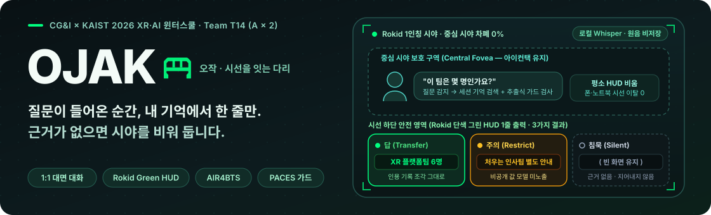

  

  <b>CG&amp;I × KAIST 2026 XR·AI 윈터스쿨 · Team T14 (A × 2)</b> 
  망설임을 구체화시키는 Zero-UI 대화 보조 AR 서비스 — <i>XR·AI로, 사람과 사람을 더 가깝게</i>

  <a href="https://github.com/ar-glass1121/glass"><b>프로젝트 (glass)</b></a> &nbsp; · &nbsp;
  <a href="#배경">배경</a> &nbsp; · &nbsp;
  <a href="#개요">개요</a> &nbsp; · &nbsp;
  <a href="#시연-영상">시연 영상</a> &nbsp; · &nbsp;
  <a href="#팀">팀</a> &nbsp; · &nbsp;
  <a href="#담당-범위-상세">담당 범위</a> &nbsp; · &nbsp;
  <a href="#리포지토리">리포지토리</a>

---

## 배경

1:1 회의나 면접 같은 대면 대화에서 *"기능을 조금 줄여야 할 것 같아요"*처럼 해석이 갈리는 추상적 표현이 나오거나 확인이 필요한 질문이 들어왔을 때, 듣는 사람은 지난 결정이나 수치를 떠올리기 위해 휴대폰·노트북을 뒤적이게 됩니다. **그 순간 상대와의 시선(아이컨택)이 끊기고 대화 흐름이 단절됩니다("시선이 끊기는 15초").** 반대로 대화 내내 시야에 UI를 띄워 두는 AR 화면 역시 집중과 라포를 해칩니다.

**OJAK(오작)** 은 견우와 직녀를 잇는 오작교에서 이름을 따, 평소에는 안경 시야를 완전히 비워 두고(`Zero-UI`) 질문이 들어온 순간에만 착용자가 이미 알고 있던 기억 한 줄을 조용히 띄워 사람과 사람 사이의 대화를 잇기 위해 개발되었습니다.

## 개요

**OJAK은 1:1 대면 대화(`A × 2`, Rokid Glasses) 중 질문이 들어왔을 때, 착용자가 보유한 세션 기억에서 근거 있는 한 줄만 단색 그린 HUD에 표시하고, 근거가 없으면 침묵하는 Symbiotic AIR4BTS · PACES 기반 AR 대화 보조 시스템입니다.**

- **Capture (포착)**: Rokid Glasses 4-마이크(또는 컴패니언 폰 마이크) 음성을 PC 로컬 `mlx-whisper`로 전사(원음 비저장)한 뒤 한국어 의문형을 감지합니다. 기존 제안의 추상어·망설임 트리거(`ASSIST_MODE=vague`)도 스위치로 함께 유지합니다.
- **Represent (기억 모델링)**: `면접 · 면접관`, `소개팅`, 사용자 세션별로 기억을 분리 관리하며, 메모·텍스트 PDF·안경 카메라 스냅샷을 사실 기록으로 적층하고 `OJAK Studio`에서 프로젝트 단위 온톨로지 관계 그래프와 충돌(`conflictsWith`)을 점검합니다.
- **Transfer (전이·가드)**: 호스팅 LLM이 세션 기록을 고르고, 결정적 추출식 가드가 *"안경의 모든 글자는 인용한 기록의 조각(또는 비공개 기록의 안전 문구)이며 폭 20 이내 한 줄인가"*를 검증해 **답(`transfer`) · 안전 문구(`restrict`) · 침묵(`non_transfer`)** 세 가지 결과만 출력합니다.
- **Verify (검증)**: 합성 평가 세트(`81`문장 튜닝 세트 + `30`문장 held-out)와 기억 추가에 따른 응답 변화 확인, 안경 카메라 기반 화이트보드·수기 합의 대조(`Visual Verify`)로 루프를 닫습니다.
- **파일럿 측정 (개발 Mac M4 · `gpt-5.1` · 합성 문장/작성자 1인 라벨 · 안경/실제 음성 미측정)**: 튜닝 81문장×3회 중 기대 일치 **96.3%(234/243)**, 답할 수 있는 질문 **135/141 정답(틀린 사실 0회)**, held-out 30문장 **29/30**(침묵해야 할 때 오출력 **0/12**), 비공개 값 노출 **0회**, 발화 끝→한 줄 **2.0–2.9초**.

## 시연 영상

<table>
  <tr>
    <td align="center" width="50%" valign="top">
       
      <b>웹앱 대시보드 (OJAK Studio)</b> 
      실행 · QR 연결 · 세션 관리 · 온톨로지 그래프 · HUD 미러 <a href="https://www.youtube.com/watch?v=7k147PfKnkk">YouTube에서 보기 ↗</a>
    </td>
    <td align="center" width="50%" valign="top">
       
      <b>핸드폰 서드파티 앱 (자체 제작 OJAK Android 앱)</b> 
      공식 Hi Rokid 앱이 아닌 CXR-L SDK 기반 자체 구현 컴패니언 (회의 · 검토 · 설정) <a href="https://www.youtube.com/shorts/_8tFABfBR_A">YouTube Shorts에서 보기 ↗</a>
    </td>
  </tr>
</table>

## 팀

<table>
  <tr>
    <td align="center" width="50%" valign="top">
       
      <b>박재현</b> 
      <a href="https://github.com/PJH720">@PJH720</a>  
      서강대학교 · XREAL 11기 풀스택 개발 (클라이언트 · 백엔드) 기억(온톨로지) · 가드 · 검증
    </td>
    <td align="center" width="50%" valign="top">
       
      <b>강정현</b> 
      <a href="https://github.com/signal0809">@signal0809</a>  
      서울여자대학교 · XREAL UX/UI 리서치 · 기획 · 디자인 발표 · 라이브 시연
    </td>
  </tr>
</table>

## 담당 범위 상세

| 담당 | 영역 | 상세 |
| :--- | :--- | :--- |
| **박재현** | 클라이언트 · 백엔드 · 기억(온톨로지) · 가드 · 검증 | Android/Rokid CXR-L 서드파티 컴패니언 앱 및 `OJAK Studio` 웹앱(클라이언트) 개발, FastAPI WebSocket/HTTP 백엔드 파이프라인, 로컬 `mlx-whisper` 전사 및 한국어 질문 감지, LLM 판정기 및 추출식 가드(`transfer`/`restrict`/`non_transfer`·긴 답 압축), 세션·PDF 사실 추출·프로젝트 온톨로지 그래프, 1회용 QR 페어링·Visual Verify, 파일럿 평가(`eval_qa.py`) 및 검증 |
| **강정현** | UX/UI 리서치 · 기획 · 디자인 · 발표 | 문제 정의("시선이 끊기는 15초") 및 유저 저니맵, 연구 가설 1–3 설계, 한국어 완화사/추상어 정량 매핑 사전, Rokid 단색 그린 HUD(20dp·시야 하단 안전 영역) UX 가이드라인 조사 및 `OJAK` 네이밍·앱 아이콘 디자인, 최종 발표 및 글래스 착용 라이브 시연 |

## 리포지토리

| 이름 | 설명 | 링크 |
| :--- | :--- | :--- |
| **glass** | OJAK 프로젝트 메인 저장소 (Rokid Glasses · Android 컴패니언 · FastAPI 백엔드 · OJAK Studio) | [리포지토리 보기](https://github.com/ar-glass1121/glass) |
| **.github** | Team T14 소개와 OJAK 프로젝트 개요를 게시하는 GitHub 조직 프로필 | [리포지토리 보기](https://github.com/ar-glass1121/.github) |

---

  <b>Team T14 · OJAK (오작)</b> 
  CG&amp;I × KAIST 2026 XR·AI 윈터스쿨 · Symbiotic AIR4BTS &amp; PACES

